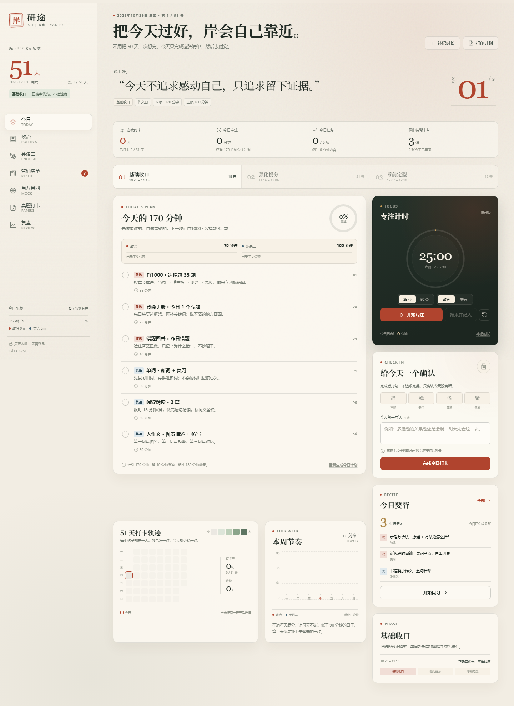

# 研途 · 五十日冲刺

**在线地址：** https://shunhu996-arch.github.io/daily-focus/  
**GitHub 仓库：** https://github.com/shunhu996-arch/daily-focus




一个**无需登录、数据只存本机**的考研政治 + 英语二冲刺打卡站。为每天最多 3 小时设计：默认计划 170 分钟，留 10 分钟缓冲，硬上限 180 分钟。

## 打开方式

### Windows（推荐）

双击 `start.cmd`。它会启动一个本地静态服务器，并打开：

```
http://127.0.0.1:5180/
```

关闭命令行窗口后，网站停止；数据仍保存在浏览器里，下次打开还在。

### 手机 / 平板访问

- **同一 Wi-Fi 临时使用**：双击 `start-lan.cmd`，按窗口提示用手机访问 `http://电脑IPv4地址:5181/`。如果打不开，在 Windows 防火墙里允许 Python 访问“专用网络”。
- **长期使用 / 随时随地打开**：把整个 `kaoyan-sprint` 文件夹部署到任意静态托管（Netlify、Vercel、GitHub Pages 等），手机、平板打开部署后的网址即可；支持添加到主屏幕。
- 手机、平板、电脑的浏览器数据**各自独立**；换设备用“导出备份 → 导入备份”。

### 其他方式

在当前目录运行任意静态服务器，例如：

```bash
python -m http.server 5180
```

然后访问 `http://127.0.0.1:5180/`。

也可以直接双击 `index.html` 使用，但浏览器的模块加载、离线缓存（PWA）在 `file://` 下可能受限，建议用本地服务器。

## 手机 / 平板

- 手机和平板（≤980px）使用**底部五项快捷导航**：今日、政治、英语、背诵、更多；完整模块仍在抽屉菜单里。
- ≥981px 使用左侧固定导航。
- 触屏设备自动放大按钮、输入框、勾选圈和热力格，输入框使用 16px 字号，避免 iOS 聚焦时页面自动放大。
- 适配 iPhone / iPad 安全区（刘海、底部 Home Indicator），支持添加到主屏幕后全屏使用。
- 手机端表单改为单列；计时器、打卡、背诵卡在今日页优先显示，统计图表放在其后。

## 功能

- **今日**：51 天倒计时、三阶段计划、每日任务勾选、专注计时（25 / 50 分钟）、打卡、今日状态与备注、本周节奏、打卡热力图。
- **政治**：选择题训练记录、分章正确率、错因标签、错题本（待回看 / 已掌握）。
- **英语二**：单词日志与生词本、阅读正确率与错因、翻译记录、作文整理。
- **背诵清单**：政治框架 + 英语作文 / 翻译 / 阅读方法，间隔复习（忘记 / 模糊 / 记住），内置 14 张起步卡。
- **肖八肖四**：8 + 4 套选择题分数、大题背诵进度、错题章节、二刷状态与分数趋势。
- **真题打卡**：2010–2026 英语二真题墙，记录总分、阅读、翻译、作文、复盘状态。
- **复盘**：14 天专注图、51 天热力图、关键指标、自动建议、每周复盘、考试日期设置、JSON 备份导入导出。

## 数据与隐私

- 所有数据保存在当前浏览器的 `localStorage`，没有账号、没有服务器、没有上报。
- **清理浏览器站点数据 / 无痕模式关闭后，记录会丢失。** 每周日复盘后点“导出备份”下载 JSON。
- 换设备时，在新设备打开网站后“导入备份”即可。
- 内置背诵卡是通用答题框架，不是押题；可自由新增、删除。

## 使用边界

- 政治“选择题训练”做的是**题量、正确数、错因与错题记录**，不内置题库；题目继续使用肖1000、肖八、肖四等纸质资料，避免版权与版本问题。
- 肖八、肖四的记录是个人分数与复盘，不包含原书题目或答案。
- 背诵卡内置的是通用答题框架，不是押题；请按自己的资料替换、补充。

## 设计说明

- 默认考试日期：**2026-12-19**（2027 考研初试，具体以官方通知为准），可在“复盘 → 基本设置”修改。
- 三阶段按距考试天数自动划分：基础收口（>33 天）、强化提分（13–33 天）、考前定型（≤12 天）。
- 每日计划为 170 分钟：政治约 70–75 分钟，英语二约 95–100 分钟。周内交替安排翻译 / 作文 / 真题复盘。
- 计划按天预生成，可查看未来安排；每天可单独重新生成当天计划。

## 文件结构

```
index.html              页面骨架
start.cmd               仅本机访问
start-lan.cmd           同一 Wi-Fi 下手机 / 平板访问
preview.png             今日页桌面预览图
preview-mobile.png      今日页手机预览图
styles.css              视觉系统与响应式 / 打印样式
manifest.webmanifest    PWA 配置
sw.js                   离线缓存
js/app.js               入口、路由、事件、计时器
js/store.js             本地数据层
js/selectors.js         派生统计与建议
js/content.js           计划生成、内置清单、常量
js/components.js        共享组件
js/charts.js            无依赖图表
js/modals.js            弹层表单
js/views/               七个页面
assets/                 图标
tools/make-icons.py     图标生成脚本（开发用）
```

